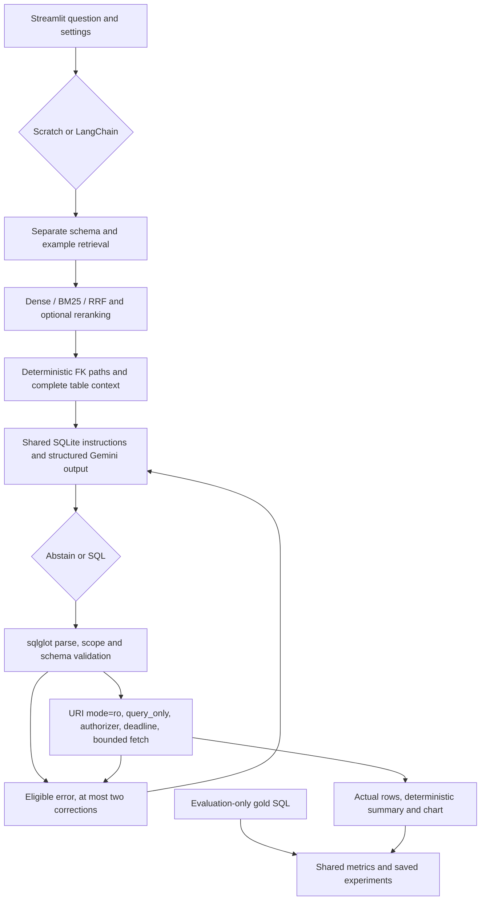

# NLP TO SQL QUERY

**Author: Kashish Rata** · [GitHub](https://github.com/kranaskt21-hash) · [Repository](https://github.com/kranaskt21-hash/NLP-TO-SQL-QUERY)

An interview portfolio for ML, NLP and retrieval-augmented generation: ask a business question about the Chinook music store, inspect retrieved evidence, generate SQLite SQL with Gemini, validate it, and run it through a restricted read-only executor. Everything runs in Python and Streamlit. There is no separate backend or custom JavaScript.

## What is implemented

- Scratch FAISS dense retrieval, BM25, hybrid reciprocal rank fusion (RRF), optional cross-encoder reranking, separately budgeted schema/example selection, and deterministic foreign-key bridge expansion.
- A comparable LangChain path using its FAISS wrapper, BM25Retriever, dynamic example selector and LCEL structured generation. Shared safety, prompts, data, execution, summaries, retries and metrics.
- Four Streamlit tabs: Ask, Compare, Experiments and Error Analysis. Includes schema browsing, evidence/scores, SQL/results, appropriate categorical charts, structured grounded summaries, visible truncation and session call quotas.
- 30 retrieval examples, 3 development questions and 60 held-out questions (20 easy, 25 medium, 15 hard). Independent Python semantic oracles for all 93 gold queries; human review is **pending**.
- Resumable controlled experiments, synthetic distractor conditions, bootstrap intervals and paired differences. No live accuracy or cost claims have been fabricated.



## Quick start — Windows PowerShell

Use Python **3.11**, the locally tested version (3.11.16). A CPU wheel is pinned for PyTorch. The first model download needs internet; weights stay in the Hugging Face cache, outside Git.

```powershell
git clone https://github.com/kranaskt21-hash/NLP-TO-SQL-QUERY.git
cd NLP-TO-SQL-QUERY
py -3.11 -m venv .venv
.\.venv\Scripts\python.exe -m pip install -r requirements.txt
Copy-Item .streamlit/secrets.toml.example .streamlit/secrets.toml
notepad .streamlit/secrets.toml
.\.venv\Scripts\python.exe -m streamlit run app.py
```

In this already-created workspace, `.venv` and the ignored placeholder secrets file already exist. Replace the placeholder rather than overwriting a real key. If `py -3.11` is unavailable, install Python 3.11 or use `uv venv --python 3.11 .venv`.

```toml
GEMINI_API_KEY = "your-real-key"
```

Environment fallback: `$env:GEMINI_API_KEY = "your-real-key"`. A placeholder in secrets does not shadow a valid environment value. Missing secrets files are handled gracefully. Never commit keys. Questions/SQL/response caches remain local in `.cache/`; per-question experiments are ignored in `results/local/`.

## Run and verify

Run module commands from the repository root:

```powershell
.\.venv\Scripts\python.exe -m scripts.build_index
.\.venv\Scripts\python.exe -m scripts.verify_data
.\.venv\Scripts\python.exe -m scripts.check_imports
.\.venv\Scripts\python.exe -m scripts.verify_project
.\.venv\Scripts\python.exe -m scripts.offline_smoke
.\.venv\Scripts\python.exe -m pytest -q
.\.venv\Scripts\python.exe -m compileall -q app.py nl2sql lc shared scripts tests
.\.venv\Scripts\python.exe -m scripts.run_experiments
.\.venv\Scripts\python.exe -m scripts.code_size
.\.venv\Scripts\python.exe -m scripts.probe_resources
```

The experiment command above is a **free dry run**. The resource probe briefly starts its own local Streamlit process and stops it; it makes no Gemini calls. `check_imports` tests installed SDKs and read-only SQLDatabase introspection, without API requests.

Direct dependencies are pinned in `requirements.txt`; `requirements-lock.txt` records the full tested Windows environment for auditing. That snapshot is not a claim of a tested Linux deployment. `langchain-classic` is required transitively by the installed `langchain-community`, not used for an unrestricted SQL agent.

## Dataset provenance and split

Only the official [Chinook repository](https://github.com/lerocha/chinook-database) is used. Database source is pinned to commit `7f67772503d71ba90f19283c38e93923addb43fa`, file `ChinookDatabase/DataSources/Chinook_Sqlite.sqlite`. The MIT license permits redistribution; the original upstream notice is retained in `data/CHINOOK_LICENSE.txt`. This notice identifies the upstream copyright holder, not this project's author.

SHA-256: `7651ba378ac2fcd0dfc3c66fb101f7a7eed3ba39a612ec642b96e20702061f15`.

See `data/provenance.json` for exact source/license URLs. `verify_data` checks integrity, foreign keys and the exact table set: Customer, Employee, Invoice, InvoiceLine, Track, Album, Artist, Genre, MediaType, Playlist, PlaylistTrack. `scripts.fetch_data` can reproduce the pinned download; run it only when intentionally restoring the bundled database.

| Split | File | Role |
|---|---|---|
| R01–R30 | `data/examples.json` | Only solved pairs accessible to the example retriever |
| D01–D03 | `data/development.json` | Prompt tuning and small live smoke tests |
| E01–E20, M01–M25, H01–H15 | `data/evaluation.json` | Held-out evaluation, loaded only by evaluation/error analysis |

Easy: one-table filtering, projection or a scalar aggregate. Medium: joins, grouped aggregates, HAVING, date grouping or one existence condition. Hard: windows, correlated aggregates, relational division, multi-stage ranking or tie-sensitive comparisons. Questions explicitly name output ordering, dates and units. Monetary ranking uses cents/rounded totals to avoid floating-point accidents in equality ties.

`data/verification.json` distinguishes automated execution, independent programmatic semantic checks and **pending human review**. `scripts/semantic_checks.py` calculates expected results from complete source tables using Python filters, joins, groups, sets and rankings. These checks are stronger than successful SQL execution but can share interpretation mistakes with the gold author. They do not establish universal correctness. See `data/REVIEW_CHECKLIST.md` for the pending review procedure and overlap audit. Automated lexical overlap checks are warnings, not proof of zero semantic leakage.

## Retrieval and index design

`nl2sql/config.py` centralizes model IDs, pinned Hugging Face revisions, encoding conventions, limits, retrieval budgets, seeds and defaults. Default generation: `gemini-3.8-flash` with low thinking (Gemini 2.5 is access-restricted for new projects per [official guidance](https://ai.google.dev/gemini-api/docs/deprecations)). SDK and LC adapters use matched thinking settings. Default retrieval: MiniLM, hybrid search, 20 candidates, 8 final schema documents, 4 examples, FK expansion, no reranker, temperature 0, up to 2 corrections. There is no answerability score threshold.

75 real schema documents describe 11 tables and 64 columns, primary/foreign keys, data types, descriptions and at most three ordered sample values per column. Examples have their own independent 30-document store. FK completion adds whole table documents for selected/bridge tables so required columns are available; the final prompt can exceed the initial schema-document budget. Evidence marks this expansion.

Dense vectors are L2 normalized and searched with `faiss.IndexFlatIP`, so inner product equals cosine similarity. Exact flat search is sufficient for tens or hundreds of documents: it avoids approximate-search tuning and permits deterministic tie breaking. FAISS metadata is position aligned. `index.faiss`, JSON metadata and a manifest record database checksum, document hash, embedding/revision, dimensions, encoding and file checksum. Stale indexes are rejected, not silently reused. Delete/rebuild an incompatible index directory using `scripts.build_index` after intentionally changing assets.

No pickle is loaded. The app has no arbitrary index-upload path: load only repository or self-built FAISS files, since FAISS's native binary parser is not an untrusted-file sandbox. Checksums establish consistency, not authenticity against an attacker replacing both file and manifest.

BM25 uses a shared identifier-aware tokenizer. Hybrid search unions separate dense/sparse candidate lists and scores documents as `sum(1 / (60 + rank))`; ID breaks ties. Optional `cross-encoder/ms-marco-MiniLM-L-6-v2` reranks the fused candidate pool. Inspect every selected score and stage in Ask/Compare. Retrieval and reranking can reduce accuracy; no gain is assumed.

Embedding options:

- `sentence-transformers/all-MiniLM-L6-v2`: normalized plain queries/documents.
- `BAAI/bge-small-en-v1.5`: the model-card query prefix is applied to questions only; documents remain unprefixed.
- `gemini-embedding-001`: currently documented stable Gemini embedding option; RETRIEVAL_QUERY / RETRIEVAL_DOCUMENT task types, normalized output. Provider-managed revisions cannot be pinned like local commits. This is deliberately not Embedding 2, whose task conventions differ.

Default public-data MiniLM indexes are committed. Query vectors still require downloading/loading MiniLM at runtime. Model weights are never committed. Only one local embedding model is retained by the bounded process cache; the optional reranker has its own single-model cache. Retrieval objects are lightweight and created per run; clients and session budgets are not shared between users through Streamlit caching.

## SQL safety, correction and summaries

Every execution calls independent validation, including retries and evaluation. SQLGlot requires one read-only SELECT/CTE/set query, validates scoped aliases/columns against the actual schema, rejects unknown tables, database qualification, commands, DDL/DML, PRAGMA, ATTACH/DETACH, multiple statements and non-allowlisted functions. Nested statements are inspected structurally, not by keyword matching. Unsupported syntax fails closed.

SQLite adds independent defenses: URI `mode=ro`, internally set `query_only`, disabled extensions, an authorizer allowing only reads/SELECT/approved functions, bounded SQL/value lengths, a progress handler deadline, and `fetchmany(limit + 1)`. The UI displays up to 200 rows and labels truncation. Evaluation uses a separate 100,000-row budget and marks a resource limit instead of comparing silently truncated output. A progress handler interrupts VM work; SQLite length limits also constrain large scalar values. These are application safeguards, not a multi-tenant process sandbox.

Prompts specify SQLite, available schema only, untrusted question/retrieval text and explicit abstention. Destructive questions cannot bypass validation even if generation follows them. Abstention is a structured model decision; retrieval similarity is not evidence that a question is answerable.

Eligible validation/SQL execution errors can trigger at most two repairs, each supplied the previous SQL, bounded error text and the same permitted context. Authentication/quota/model transport failures never become SQL corrections. Rate-limit/service failures use bounded transport retries; each attempted provider request consumes budget. Native SDK retries are disabled so they cannot silently bypass call accounting.

Both paths use a deterministic Pydantic summary payload and result-grounded text instead of a second LLM summary call. Counts, columns and a first-row preview come from actual rows. Result and preview truncation are explicit. This substitution avoids summary hallucination and extra paid calls; it is not an independently measured LLM summarization capability.

## Scratch versus LangChain

| Concern | Scratch | LangChain |
|---|---|---|
| Dense retrieval | FAISS IndexFlatIP directly | FAISS wrapper around identical index and shared embedding adapter |
| Sparse retrieval | rank_bm25 directly | BM25Retriever, shared deterministic tie correction |
| Hybrid/reranking | Shared RRF and cross-encoder | Same shared algorithms after genuine LC retrieval |
| Few-shot selection | Separate scratch example search | BaseExampleSelector implementation invoking LC retriever |
| Generation | google-genai structured JSON | ChatPromptTemplate → ChatGoogleGenerativeAI structured output → LCEL parser |
| SQLDatabase | Direct schema introspection | Read-only SQLDatabase utility available for introspection only |
| Safety/execution/metrics | Shared | Shared |

The complete scratch pipeline is never invoked as a LangChain retrieval shortcut: a shared coordinator chooses different retrievers and model orchestrators. SQLDatabase is a diagnostic utility, not a SQL agent. SDK message envelopes and usage metadata can differ even with matched text instructions. Exact token equality or provider output determinism is not guaranteed by temperature 0.

The installed `langchain-community` emits a sunset deprecation warning. Its actual FAISS/BM25/SQLDatabase imports work in the pinned tested environment. Shared RRF replaces moved/deprecated ensemble helpers, so no old chain API is assumed. See official upstream source/reference links below. Revisit integrations before a future upgrade.

`python -m scripts.code_size` writes per-file and group physical nonblank/non-comment line counts to `results/code_size.json`. Shared coordination belongs to both implementations, so the adapter count is not an independent total application size. Counts are not complexity or engineering-quality scores.

## Experiments and budgets

```powershell
# Three DEVELOPMENT questions, both implementations; actual requests require a key
.\.venv\Scripts\python.exe -m scripts.run_experiments --suite smoke --live --call-budget 12 --token-budget 100000

# Inspect the full planned one-factor suite without spending
.\.venv\Scripts\python.exe -m scripts.run_experiments --suite full

# Explicit opt-in for the 60-question suite; budgets are ceilings, not a promise to finish
.\.venv\Scripts\python.exe -m scripts.run_experiments --suite full --live --full-paid --call-budget 2000 --token-budget 15000000 --output results/local/full

# Run a smaller hand-selected matched condition file
.\.venv\Scripts\python.exe -m scripts.run_experiments --config experiments/smoke.json --live --call-budget 12 --token-budget 100000
```

`experiments/full.json` materializes the 22 controlled conditions. The baseline supplies hybrid, MiniLM, 4 retrieved examples, FK on, 2 corrections and no noise. One-factor variants cover dense/BM25, reranker on, 0/2/8 examples, random selection, FK off, 0/1 corrections, BGE/Gemini embeddings. Baseline values complete 0/2/4/8 examples, 0/1/2 corrections and all embedding options. Full/retrieved schema pairs use 0/25/50/100 distractors. The duplicate retrieved/no-noise control is explicit for matched noise interpretation. No huge Cartesian product is run.

Full paid mode always requires `--full-paid`, a call budget and a token budget, even with a custom configuration file. Request estimates include maximum generation repairs and transport retries; remote embedding builds/queries are additional and count toward the same call budget. A token budget conservatively reserves UTF-8 input bytes plus maximum output and settles to actual provider usage when available. It is an operational ceiling, not a monetary spending guarantee; provider accounting and unknown failed-request usage can differ. Gemini embedding usage keeps conservative reservations when usage is unavailable. No sourced pricing table is configured, so monetary cost is **unavailable**.

Run keys include question set/config hashes; response cache keys include exact prompt, model/settings, implementation, database/schema/document hashes and encoding. Changing context/settings causes misses and costs requests. Scratch and LC response keys are isolated. Cache hits carry original usage provenance and explicit hit labels; they are not fresh calls. Fresh-only latency excludes cached/mixed runs. Local models/indexes/reranking are prewarmed outside per-question timing for experiments; this preparation time is recorded separately. Interactive first-use latency still includes cold loading. Neither reruns nor changed settings are promised to be free. Raw responses/questions stay ignored locally; sanitized aggregate public-data results can be deliberately exported after inspection. No raw caches are committed.

Per-question JSONL stores SQL, evidence, errors, retries, timing, tokens when available, cache status and configuration fingerprint. Separate configuration JSON records versions, seeds and timestamps. A stopped budget/quota run can be resumed by repeating the identical command and output directory; completed IDs are skipped. To independently rerun completed conditions, choose a new output directory and disable cache in a config file. The seed controls random examples, distractors and bootstrap draws.

Synthetic tables are prompt/index documents only: the real database remains unchanged. This measures **synthetic schema-noise robustness**, not scalability to a real 111-table database. Full and retrieved conditions use the same noise corpus/seed. Distractor selection is recorded as an error even if the final SQL succeeds; references to those nonexistent tables are blocked. Prompt character counts and actual generation token usage help interpret context growth. Retrieval can degrade.

## Metrics and interpretation

- Execution accuracy; normalized SQL exact match is secondary and only normalizes formatting/identifier case, not semantic equivalence.
- Table and column recall of available retrieved/expanded context against qualified gold references. Complete table docs supply all that table's columns. This measures context coverage, not the precision of generated SQL.
- Parse-valid rate separately from execution-success rate; abstention and resource-limit counts; self-correction success conditional on eligible initial failures.
- Per-stage/total latency, difficulty breakdowns, provider token usage (null when unavailable), cache provenance, bootstrap 95% percentile intervals and paired bootstrap accuracy differences on matched IDs.

Unordered outputs use multiset matching, preserving duplicates. Exact matches are fast-pathed; tolerant bipartite row matching prevents greedy numeric matches from hiding multiplicity. Column order and output width are preserved; names/aliases need not match. NULL equals only NULL; strings are not coerced to numbers. Numeric `rtol=1e-6`, `atol=1e-8`. Gold top-level ORDER BY requires row order; the comparator also supports explicit tie groups. Gold ranking tasks specify tie policy/deterministic secondary keys. Float monetary ties are stabilized in gold SQL.

Star expansion and scoped references use SQLGlot qualification; unsupported extraction is marked rather than guessed. Empty results retain shape checks, but identical empty results or two incorrect queries returning the same rows can still inflate apparent correctness on a single static database. Resource limits have unavailable accuracy and separate counts/denominators, never an automatic correct comparison.

The 60 questions are small and hand-authored for one schema. If repeatedly used to select settings, all resulting comparisons are **exploratory**. Multiple comparisons, correlated questions and pending human labels limit statistical inference; differing means do not establish significance. Use development questions for tuning, then freeze settings before evaluation.

## Actual verification and results

See `results/verification_report.json`, `data/verification.json` and `results/resource_probe.json` for recorded checks and environment details. Offline tests mock external generation. Independent semantic checks and real local MiniLM index construction are not live Gemini tests.

**Live execution accuracy, ablation results, API cost, and cloud performance: not yet measured.** No usable Gemini key was available. The Experiments UI shows an empty state until actual run files exist. No live results table is pre-populated.

## Deployment and resource use

The default uses one small CPU embedding model and optional reranking off. Models and LC generation imports are lazy; a single-model LRU prevents retaining every embedding option. Do not cache per-user keys or budgets with `st.cache_resource`. This app does not need a cross-user pipeline resource cache: immutable model loading already has a bounded cache. Generated output is held in session state and invoked only on form submission, avoiding duplicate API calls on reruns.

Local Windows measurement: server health about 1.9 s, in-process UI execution about 1.6 s, first local query with model files already downloaded about 8.7 s; UI-plus-embedding RSS about 610 MiB. See the timestamped report rather than treating these numbers as universal or peak memory. Reranking, concurrent sessions and larger models can use more. BM25 avoids embedding model loading when local resources are constrained.

Community Cloud's [current management docs](https://docs.streamlit.io/deploy/streamlit-community-cloud/manage-your-app) describe resource limits and over-limit behavior; they do not establish a fixed guaranteed 1 GB allocation. This project does not promise cloud memory compatibility. Local Windows imports were tested; Linux wheel availability and actual cloud memory must be checked during deployment.

1. Push/choose this public GitHub repository, branch `main`, entrypoint `app.py`.
2. Sign in to [Streamlit Community Cloud](https://share.streamlit.io/) and create an app with Python 3.11.
3. Add `GEMINI_API_KEY` using Advanced settings → Secrets. Never paste secrets into repository files.
4. Deploy, inspect build/runtime logs, and check Ask with a development question. Start with reranking off; use BM25 if memory is tight.
5. Keep the ignored local secrets file out of Git. Public deployments need additional authenticated usage controls before exposing a paid key broadly: this session quota is resettable, not an account-wide abuse barrier.

No authenticated Streamlit deployment access was available in this session; **no deployment URL is claimed**. GitHub authentication alone does not authenticate Community Cloud.

Troubleshooting: missing key → replace the placeholder or set the environment variable; 401/403 → check key permissions; 429 → stop/resume within provider quotas; model unavailable → change `Config.model` to an accessible supported Gemini model; cold download → verify Hugging Face connectivity; stale index → rebuild with matching revision/database/documents; no CPU wheel on your platform → use Python 3.11 and verify the pinned CPU index; memory pressure → BM25, no reranker, restart to release model caches. The local health probe bypasses HTTP proxies for loopback.

## Layout, limitations and future work

`app.py` is UI orchestration; `shared/ui.py` renders results. `nl2sql/` contains retrieval, schema linking, generation and safety; `lc/` contains LC retrieval/selector/LCEL adapters; `shared/` contains the protocol, metrics and experiments; `scripts/` contains runnable tooling. Data and public indexes are reproducible assets, not secret/query caches.

Limitations include one small English schema, hand-written labels pending human review, imperfect answerability decisions, approximate retrieval relevance, provider/model drift, no process-level sandbox and no verified hosted deployment. Future work: Spider/BIRD evaluation with their licensing/protocols, multi-database schema generalization, richer answerability calibration, adversarial testing, query-plan limits and account-level quota persistence. Those are future ideas, not measured capabilities.

## Official API references checked

- [Gemini structured output](https://ai.google.dev/gemini-api/docs/structured-output), [embedding models/task conventions](https://ai.google.dev/gemini-api/docs/embeddings).
- [LangChain Gemini integration](https://docs.langchain.com/oss/python/integrations/chat/google_generative_ai), [official FAISS wrapper source](https://github.com/langchain-ai/langchain-community/blob/main/libs/community/langchain_community/vectorstores/faiss.py), [official BM25 reference](https://reference.langchain.com/python/langchain-community/retrievers).
- [BGE model card](https://huggingface.co/BAAI/bge-small-en-v1.5), [MiniLM model card](https://huggingface.co/sentence-transformers/all-MiniLM-L6-v2).
- Streamlit API guidance was read from the installed version's bundled skill/reference documentation; actual imports, AppTest and server health were also checked.

## Diagnosing a model request failure

The sidebar now exposes **Gemini generation model** and **Gemini connection check ? Check connection**. The check sends no business question: it reads one model-catalog page and requests a tiny structured response through the selected scratch/LangChain adapter. It makes at most two requests, counts both toward the session budget, disables response caching/retries, and may consume paid quota. A catalog listing alone does not prove generation entitlement or remaining quota.

Save your key in Community Cloud **Settings ? Secrets**, then reboot the app. Do not paste keys into chat, logs, or GitHub. Newly issued authorization keys are supported; no legacy-prefix validation is imposed. If a key was shared, replace it in AI Studio and update Secrets.

Errors now show a fixed actionable category, nested exception types, HTTP status when available and source-file/line locations. Raw provider messages, request URLs, headers, response content and traceback locals are never displayed. A bare RuntimeError does not identify the cause. For example, 401/403 indicate authentication/permissions, 404 model access, 429 quota, and network/TLS failures have a separate category. The app explicitly selects the Gemini Developer API and uses a 60-second default request timeout. No live connection success is claimed without an actual provider response.

For the development question ?How many tracks belong to genre ID 7??, the bundled SQLite database returns **579** using `SELECT COUNT(*) FROM Track WHERE GenreId = 7`. This confirms the database answer, not successful model generation.

The original scratch adapter used a temporary `Client(...).models` expression. With the pinned SDK, the parent client's destructor closes its HTTP transport before `generate_content` runs, causing `RuntimeError: Cannot send a request, as the client has been closed.` The adapter now retains the client until the request finishes and closes it in `finally`. A real-SDK test with a mocked HTTP transport reproduces the lifecycle behavior and verifies the fix without a key or network. This is separate from live API verification.

### Gemini 504 / deadline exceeded

A 504 is a provider/gateway deadline failure, not an SQLite error. The generation wrapper retries transient HTTP 408/429/500/502/503/504 and client timeouts at most once by default, with each attempt charged to the shared call budget. SDK-internal retries remain disabled. Authentication/configuration failures are not retried as SQL problems. The explicit connection check still uses no retries and at most two requests.

The default per-request timeout is now 60 seconds; the sidebar **Model request timeout (seconds)** allows 15?120 seconds. This does not change the SQLite execution deadline. A larger timeout cannot guarantee recovery from a provider-side timeout/outage. Try 90 seconds, 0 or 2 examples, retrieved schema, no distractors, and reranking off. Alternatively select an accessible lower-latency model such as `gemini-3.5-flash-lite` in the model field, then run the connection check. Changing models/settings changes experiment/cache identity. Timed-out requests may still consume provider quota; no failed-request token usage is invented.
